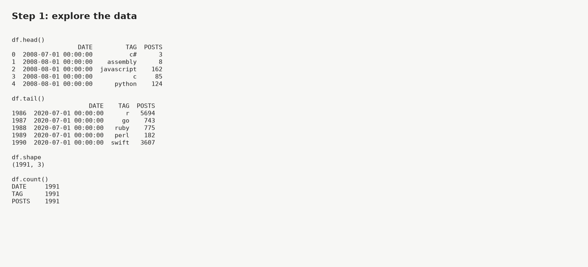
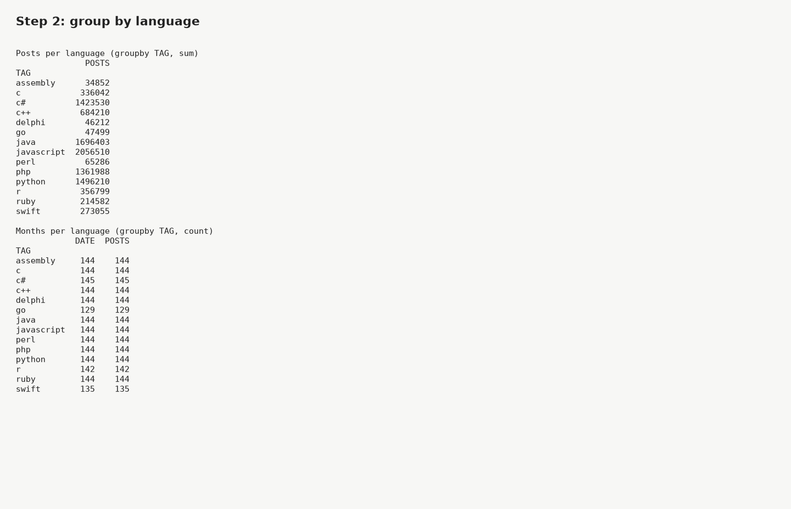
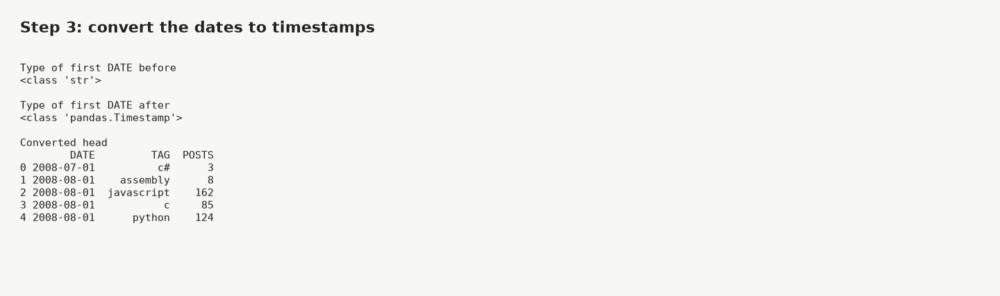
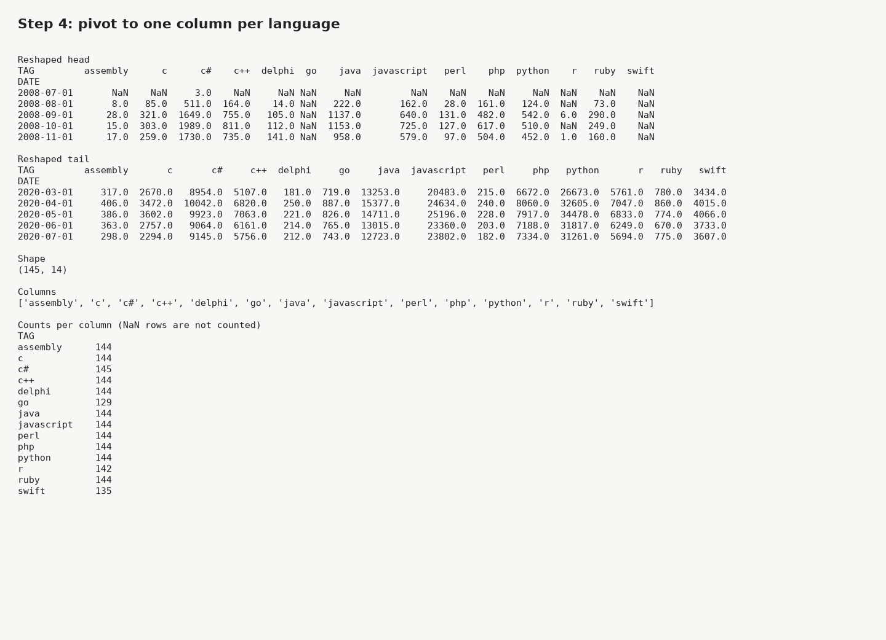
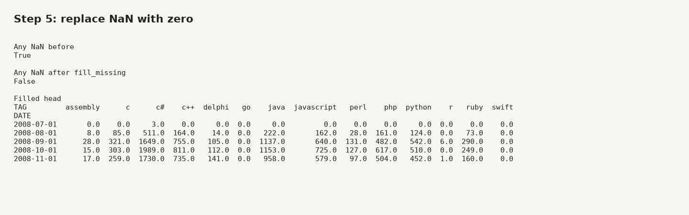
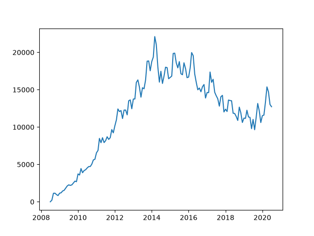
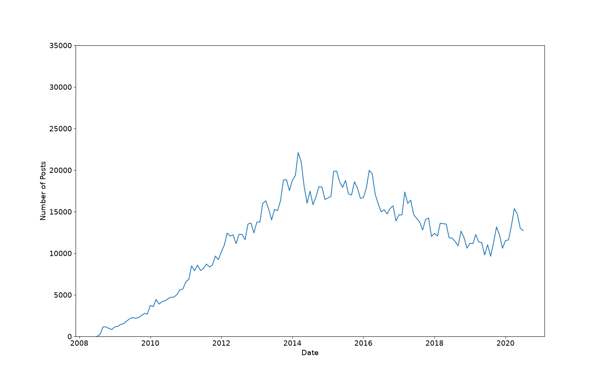
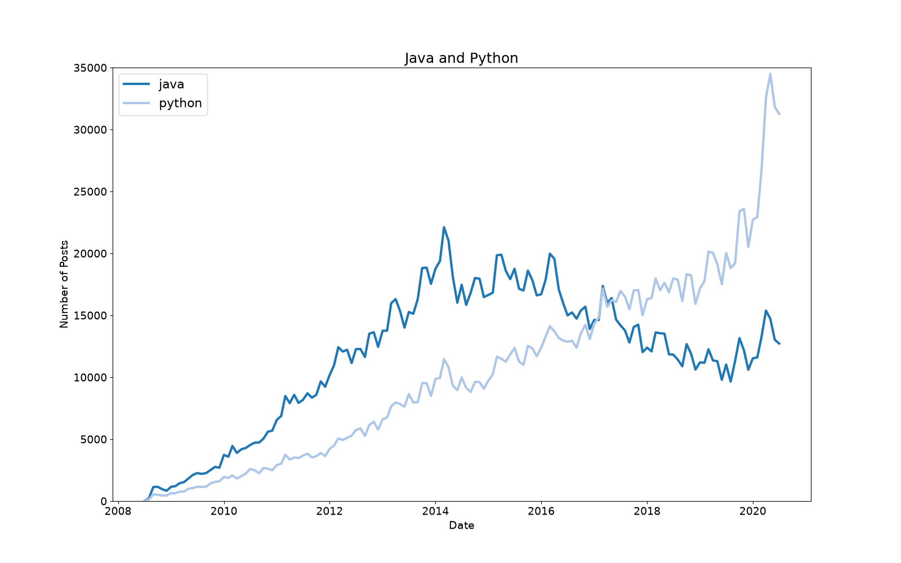
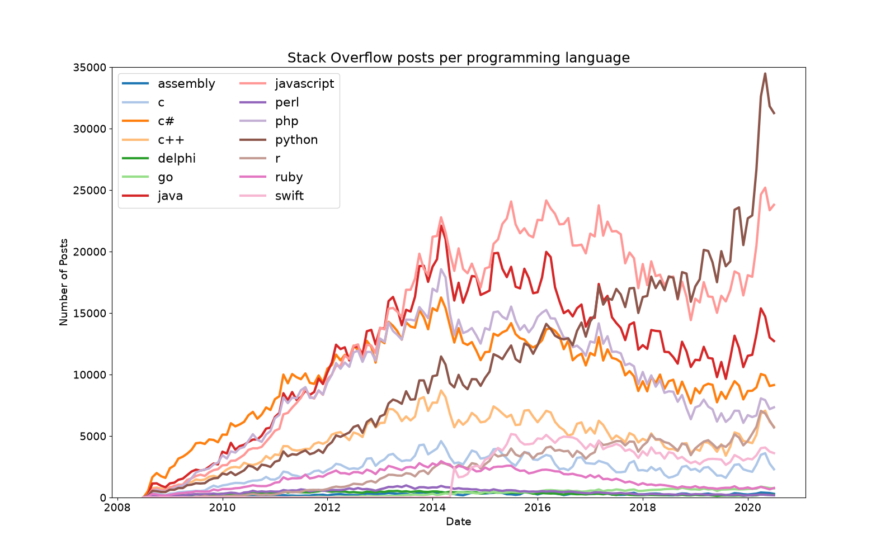
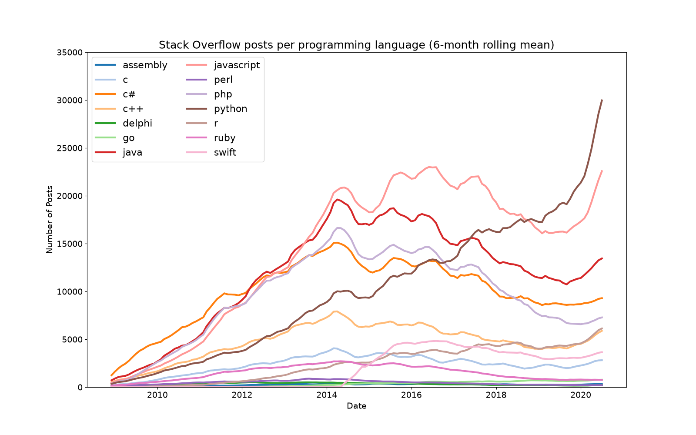

# 🚀 Programming Languages: Day 73 of 100 Days of Code

Which programming language is the most popular? This project answers it by counting Stack Overflow posts per language tag with pandas and Matplotlib, as an assignment of Udemy's "100 Days of Code: The Complete Python Pro Bootcamp". It is for course participants who want runnable, readable code and for visitors looking for ideas.

## 📚 Table of Contents

- [Overview](#-overview)
- [Requirements](#-requirements)
- [Setup](#-setup)
- [Run](#-run)
- [Tests](#-tests)
- [License](#-license)
- [Links](#-links)
- [Appendix: Project documents](#-appendix-project-documents)

## 🧭 Overview

The analysis follows the lecture step by step: explore the data, group by language, convert dates, pivot, fill missing values, plot one language, style the chart, plot several languages, plot all languages with a legend and smooth the lines with a rolling mean.

| Folder | Purpose |
| --- | --- |
| `src/programming_languages/` | The package with the functions of the assignment |
| `tests/` | Automated tests |
| `docs/` | Project documents, the screenshots in `docs/images/` and the wiki sources in `docs/wiki/` |
| `notebooks/` | The Jupyter notebook that follows the lecture |
| `data/` | `QueryResults.csv`, the Stack Overflow export used by the lecture |

All four milestones are done; see the milestones in the appendix.

### The lecture steps

Each step has a screenshot (made by `python -m programming_languages.presentation.screenshots`) and a function of the same name as in the assignment. The wiki explains what each step teaches, in English, Danish and Bahasa Malaysia.

| Step | Functions |
| --- | --- |
| Step 1: explore the data | `load_data`, `explore_data` |
| Step 2: group by language | `posts_per_language`, `months_per_language` |
| Step 3: work with timestamps | `convert_dates` |
| Step 4: pivot the DataFrame | `reshape_data` |
| Step 5: replace NaN values | `fill_missing` |
| Step 6: plot one language | `plot_language(styled=False)` |
| Step 7: style the chart | `plot_language` |
| Step 8: two lines in one chart | `plot_languages(languages=[...])` |
| Step 9: all languages with a legend | `plot_languages` |
| Step 10: smooth with a rolling mean | `rolling_mean` |

#### Step 1: explore the data



#### Step 2: group by language



#### Step 3: work with timestamps



#### Step 4: pivot the DataFrame



#### Step 5: replace NaN values



#### Step 6: plot one language



#### Step 7: style the chart



#### Step 8: two lines in one chart



#### Step 9: all languages with a legend



#### Step 10: smooth with a rolling mean




## 📋 Requirements

- Python 3.13 or newer, because the project targets it (`requires-python` in `pyproject.toml`).
- `pandas` and `matplotlib`, the only runtime dependencies.
- Development extras (`pytest`, `jupyter`, `ruff`, `mypy`) are installed only with `.[dev]`.

## 🛠️ Setup

Create and use a local virtual environment in `.venv`. On Windows, in PowerShell:

```powershell
python -m venv .venv
.venv\Scripts\Activate.ps1
```

In Git Bash on Windows, Linux and macOS:

```bash
python -m venv .venv
source .venv/Scripts/activate   # Git Bash on Windows
source .venv/bin/activate       # Linux and macOS
```

Upgrade pip, then install the project with the development extras:

```bash
python -m pip install --upgrade pip
python -m pip install -e ".[dev]"
```

Leave the environment with `deactivate`. Delete `.venv/` to start over.

## ▶️ Run

Open the notebook in Jupyter and run all cells:

```bash
jupyter lab notebooks/programming_languages.ipynb
```

Or regenerate the ten screenshots from the command line:

```bash
python -m programming_languages.presentation.screenshots --output docs/images
```

## 🧪 Tests

```bash
python -m pytest
```

Before a push, scan the tracked files with opengrep (it must not report an `ERROR`; the `.env` file is personal and never scanned or committed):

```bash
~/.opengrep/cli/latest/opengrep.exe scan --config auto --error --exclude .env .
```

## 📄 License

[AGPL-3.0](./LICENSE)

## 🔗 Links

- [Repository][repository]
- [Documentation][documentation]
- [Issue tracker][issues]

## 📎 Appendix: Project documents

| Document | What it tells you |
| --- | --- |
| [AGENTS.md][agents] | The rules AI agents follow in this repository |
| [Business Case][BC-001] | Why the project exists, its scope and success criteria |
| [Stakeholder Analysis][SA-001] | Who is involved; the stakeholder IDs used for owners and reviewers |
| [Project Plan][PP-001] | The gateways and their schedule |
| [Milestones][milestones] | One document per gateway: Go/No-Go criteria and tasks |
| [Artifact registry][registry] | Where each artifact type lives, the next version, the PO language and domain |

---

[repository]: https://git.tirsystem.com/Tirsvad-Udemy-100-days-of-code/073-data-visualisation-programming_Languages
[documentation]: https://git.tirsystem.com/Tirsvad-Udemy-100-days-of-code/073-data-visualisation-programming_Languages/wiki
[issues]: https://git.tirsystem.com/Tirsvad-Udemy-100-days-of-code/073-data-visualisation-programming_Languages/issues
[agents]: ./AGENTS.md
[BC-001]: ./docs/business-case.md
[SA-001]: ./docs/stakeholder-analysis.md
[PP-001]: ./docs/project-plan.md
[milestones]: ./docs/milestones/
[registry]: ./docs/artifact-registry.md
