# Project Plan

## Metadata
| Key | Value |
| --- | --- |
| ID | PP-001 |
| CrossReference | [BC-001], [SA-001], [MIL-001], [MIL-002], [MIL-003], [MIL-004] |
| Language | en |
| Domain | it |

## Version History
| Date | Status | Author | Reviewer | Change | Commit |
| --- | --- | --- | --- | --- | --- |
| 2026-11-11 | Accepted | Jens Tirsvad Nielsen | S01 (AI as stand-in) | Initial version (RC-003 Go) | pending |

---

## Purpose

Schedule the four gateways that deliver the Day 73 project inside the Business Case constraint (finish by 2026-11-14, no budget).

## Planning Assumptions

- The plan starts 2026-11-11 and ends 2026-11-14, per the Business Case Constraints ([BC-001]).
- One gateway per day; each ends in one pull request and an `RC-*` review.
- S01 owns every gateway; the AI is stand-in reviewer in autonomous mode (not independent), as [SA-001] records.
- The data file may be unobtainable; that is handled in MIL-002 and stops the run (BC-001 Risks).

## Gateway Schedule

| Gateway | Document | Window | Decision date | Owner | Stories | Main deliverable | Milestone |
| --- | --- | --- | --- | --- | --- | --- | --- |
| Setup | [MIL-001] | 2026-11-11 | 2026-11-11 | S01 | none (technical tasks) | Project skeleton, README with venv instructions, repository description and topics | not yet synced |
| Data | [MIL-002] | 2026-11-11 to 2026-11-12 | 2026-11-12 | S01 | none (technical tasks) | Dataset and the tested data preparation functions | not yet synced |
| Charts | [MIL-003] | 2026-11-12 to 2026-11-13 | 2026-11-13 | S01 | none (technical tasks) | Tested chart functions and step screenshots | not yet synced |
| Docs | [MIL-004] | 2026-11-13 to 2026-11-14 | 2026-11-14 | S01 | none (technical tasks) | Notebook, README screenshots and the three-language wiki | not yet synced |

```plantuml
@startgantt
Project starts 2026-11-11
[Setup] starts 2026-11-11 and ends 2026-11-11
[Setup Go/No-Go] happens 2026-11-11
[Data] starts 2026-11-11 and ends 2026-11-12
[Data Go/No-Go] happens 2026-11-12
[Charts] starts 2026-11-12 and ends 2026-11-13
[Charts Go/No-Go] happens 2026-11-13
[Docs] starts 2026-11-13 and ends 2026-11-14
[Docs Go/No-Go] happens 2026-11-14
@endgantt
```



## Scope Coverage

| Business Case scope item | Gateway |
| --- | --- |
| Python package under `src/`, tests under `tests/`, documents under `docs/` | MIL-001, MIL-002, MIL-003 |
| `pyproject.toml`, Python `.gitignore`, `.venv` instructions, README from the template | MIL-001 |
| A Jupyter notebook following the lecture | MIL-004 |
| Screenshots per lecture step; wiki in en, da, ms | MIL-003 (images), MIL-004 (README and wiki) |
| Static analysis with opengrep before every push | MIL-001 (set up), every gateway (run) |

## Dependencies

```
MIL-001 → MIL-002 → MIL-003 → MIL-004
```

A No-Go on a gateway moves every later gateway and the end date by the time needed to fix it; S01 decides the new end date.

## Plan Risks

| Risk | Impact | Mitigation |
| --- | --- | --- |
| The data file link has expired (BC-001 Risks) | MIL-002 cannot finish, later dates slip | Ask S01 for the file; the run stops and reports |
| A review fails three rounds in a row | Gateway slips | Stop and report as `AGENTS.md` says |
| Wiki in three languages takes longer than one day | MIL-004 slips | The end date is a target without a deadline; S01 may move it |

## Open Issues

- The signed Udemy download links in the assignment may have expired; confirmed when MIL-002 starts.
- The assignment names no functions, so the public names are proposed here: `load_data`, `posts_per_language`, `months_per_language`, `convert_dates`, `reshape_data`, `fill_missing`, `plot_language`, `plot_languages`, `rolling_mean`; S01 may rename them when accepting the plan.

---

[BC-001]: ./business-case.md
[SA-001]: ./stakeholder-analysis.md
[MIL-001]: ./milestones/mil-001-setup.md
[MIL-002]: ./milestones/mil-002-data.md
[MIL-003]: ./milestones/mil-003-charts.md
[MIL-004]: ./milestones/mil-004-docs.md
